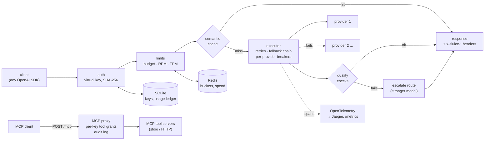

# Sluice

An OpenAI-compatible LLM gateway, built phase by phase as a learning project. It
sits between applications and model providers and decides how much traffic flows, where it
goes, and when to shut it off. It handles keys, rate limits and budgets, retries, fallback and
circuit breaking, tracing and cost attribution, a semantic cache, cheap-first routing, stream
resume after a mid-answer failure, an MCP tool proxy with per-key permissions, and hardening
against the ways AI gateways were attacked in 2026 (ADR 0010).

**Total spent on LLM APIs: $0.** Every model call in this repo went to a mock upstream or to a
local Ollama model. Paid providers are blocked unless `SLUICE_ALLOW_PAID=1`, and even then
they are capped per day.

## How a request flows



Every response carries `x-sluice-trace-id`, `x-sluice-provider`, `x-sluice-attempts`, and where
relevant `x-sluice-cache` and `x-sluice-escalated`.

## Results

Every number below comes from a script in `bench/` and is written to a file in
`bench/results/`. They are from one 8 GB MacBook Air (M2). Re-run them before trusting them on
other hardware.

| Claim | Number | Script → result |
|---|---|---|
| Failover under injected faults | 100% success in all 5 fault scenarios (primary down, 429s, 30% flaky, slow); a recovered primary serves again within the 1 s breaker cooldown (0.97 s) | `bench/chaos.py` → [chaos.md](bench/results/chaos.md) |
| Mid-stream failure | terminal SSE error event, no `[DONE]` (ADR 0001) | `bench/chaos.py` → [chaos.md](bench/results/chaos.md) |
| Limits hold across 2 replicas | exact: 30/100, 60/100, 10/100 allowed for keys limited to 30, 60, 10 RPM | `bench/ratelimit.py` → [ratelimit.json](bench/results/ratelimit.json) |
| A failed-over request explained by its trace | span tree + cost row joined by trace id | `bench/trace_demo.py` → [trace-failover.md](bench/results/trace-failover.md) |
| Semantic cache | 86% hit rate on true repeats, **3 of 33 hits wrong (9%)** on held-out pairs; without the lexical guard, no threshold was usable | `bench/cache_eval.py` → [cache-eval.md](bench/results/cache-eval.md) |
| Cheap-first routing | **no gain**: 1B model 82% vs 7B 80% / 3B 85%; free checks fired 1 in 60 | `bench/routing_collect.py`, `routing_eval.py` → [mistral](bench/results/routing-eval-mistral.md), [qwen2.5](bench/results/routing-eval-qwen2.5.md) |
| Overhead vs LiteLLM, same mock upstream | p50: Sluice +0 to +5 ms, LiteLLM +2 to +8 ms; p99 at 150–250 rps: Sluice within noise of direct, LiteLLM +42 to +147 ms | `bench/compare.py`, `compare_report.py` → [compare.md](bench/results/compare.md) |
| Failover vs LiteLLM (30% faulty primary) | both 100% success; p99 Sluice 228 ms, LiteLLM 2.8 s (one run each) | same → [compare.md](bench/results/compare.md) |
| Bug found by benchmarking | cancelled httpx calls leaked pool slots (22 → 100, then dead); fixed: 0% → 100% success after an overload | `bench/httpx_pool_leak.py` → [httpx-pool-leak.md](bench/results/httpx-pool-leak.md), ADR 0007 |
| Top profiling hotspot | per-request SQLite commit on the event loop, ~19% of CPU; now batched off the loop | `bench/profile_sluice.py` → [before](bench/results/profile-before-flat.txt) / [after](bench/results/profile-after-flat.txt) |
| Stream resume after a mid-answer failure | prefill: 30/30 clean (same model), 29/30 (other model); silent restart: 0/30 | `bench/stream_resume_eval.py` → [stream-resume.md](bench/results/stream-resume.md) |

Where Sluice loses to LiteLLM (providers, admin UI, key management, budgets per team/user,
integrations, maturity): see the feature table in [compare.md](bench/results/compare.md).

## Quick start

```bash
python3 -m venv .venv && .venv/bin/pip install -e '.[dev]'
.venv/bin/python -m sluice.admin create-key --name demo --team search --rpm 30 --daily-budget 0.01
.venv/bin/uvicorn sluice.api.app:app_factory --factory --port 8000
curl localhost:8000/v1/chat/completions -H "Authorization: Bearer <key>" \
  -H 'content-type: application/json' \
  -d '{"model":"mock-model","messages":[{"role":"user","content":"hi"}]}'
```

The default policy (`policies/routes.yaml`) routes `mock-model` to the built-in mock and
`local-small` / `auto` to Ollama (`ollama pull llama3.2:1b mistral nomic-embed-text`).
Two replicas + Redis + Jaeger: `docker compose up` (policy `policies/compose.yaml`).

| Feature | How | Decision |
|---|---|---|
| Fallback, retries, breaker | `chain:` per route, `retries`, `timeout_s`, `deadline_s` | ADR 0001, 0002, 0007 |
| Keys, limits, budgets | `python -m sluice.admin create-key ...`; Redis for multi-replica | ADR 0003 |
| Traces, metrics, cost | Jaeger via `telemetry.traces: otlp`; `GET /metrics`; `python -m sluice.report --by team` | ADR 0004 |
| Semantic cache | `cache: true` on a route; `Cache-Control: no-cache` / `no-store` honoured | ADR 0005 |
| Quality routing | `escalate:` route + `escalate_on:` checks | ADR 0006 |
| Stream resume | `stream_resume: prefill` on a route (backup must honour prefill) | ADR 0008 |
| MCP proxy | `mcp.servers` in the policy; keys get `--tools "server__tool*"` grants; `python -m sluice.report --mcp` | ADR 0009 |
| Hardening | tool servers never see provider keys; admin API loopback-only or `SLUICE_ADMIN_TOKEN`; every route classified in `tests/test_invariants.py`; hash-pinned `requirements*.lock`; CI with `pip-audit` | ADR 0010 |

## Workbench UI

`UI/` is a Vite + React app for seeing all of the above. It has a lab that sends real requests and
replays each one through the pipeline from its trace, plus the policy, ledger, keys, MCP audit,
every benchmark result, the ADRs and the commit history. It reads a read-only admin API
(`/v1/sluice/admin/*`, off by default; `admin.enabled` in the policy). That API answers loopback
clients only, unless `SLUICE_ADMIN_TOKEN` (32+ characters) is set; then it needs that token,
never a virtual key (ADR 0010). `policies/lab.yaml` turns
the API on and adds mock routes that fail on purpose. Setup is in [UI/README.md](UI/README.md).

## Tests and benchmarks

```bash
redis-server --port 6399 --save "" &      # optional: the Redis tests skip without it
.venv/bin/pytest                          # 157 tests, ~5 s
```

The LiteLLM comparison needs LiteLLM in its own environment (pinned, Python 3.12) and uvloop:

```bash
python3.12 -m venv bench/.venv-litellm && bench/.venv-litellm/bin/pip install "litellm[proxy]==1.103.1"
.venv/bin/pip install -e '.[dev,bench]'                   # uvloop + pyinstrument, pinned
.venv/bin/python bench/compare.py --tag mine && .venv/bin/python bench/compare_report.py mine
```

Dependencies are pinned by hash in `requirements.lock` (runtime, used by the Dockerfile) and
`requirements-dev.lock` (CI). Both are resolved for Python 3.12 on Linux; ADR 0010 has the
command that regenerates them. CI (`.github/workflows/ci.yml`) runs ruff, the tests with Redis,
and `pip-audit` on both locks.

## Layout

```
src/sluice/   api/ (FastAPI app, SSE)  providers/ (mock, OpenAI-compatible)  router/ (executor,
              breaker)  auth/  limits/ (Redis Lua buckets)  telemetry/ (OTel, ledger)  cache/
              quality/  mcp/ (endpoint, upstreams, audit)  api/admin.py (read-only API for the UI)
              admin.py  report.py
policies/     routes.yaml (local), compose.yaml (docker), lab.yaml (the UI's lab)
UI/           workbench UI (Vite + React); see UI/README.md
bench/        load generator, mock upstream, every experiment; results/ holds their output
docs/         decisions/ (ADRs 0001-0010), learning/ (one note per phase, with questions)
```

## Definition of done

- [x] Failover demonstrated under injected failure, with numbers in `bench/results/`
- [x] Streaming failure behaviour documented and tested (ADR 0001)
- [x] Limits verified across multiple instances
- [x] Cache false-hit rate reported alongside hit rate
- [x] Routing result reported honestly, including negative results
- [x] Comparison with LiteLLM on the same mock upstream, including weaknesses
- [x] Every number in this README links to a script and a result file
- [x] Total money spent on LLM APIs: $0

## Known limits

- One OpenAI-compatible adapter. Azure OpenAI and Bedrock (the third Phase 8 item) are not built.
- Stream resume's `prefill` was measured on Ollama only; some providers don't honour a trailing
  assistant message (ADR 0008).
- MCP: tools only (no resources/prompts), no rate limits on tool calls (ADR 0009). Tool
  definitions aren't pinned yet, so a server can change a tool's description after you grant
  it. Pin MCP server packages to exact versions in the policy (`npx -y package@1.2.3`, not a
  bare name).
- Virtual keys don't expire, and nothing suspends a key that behaves oddly (ADR 0010).
- The semantic cache is per process. pgvector would share it across replicas; it needs Docker.
- The cache eval's labels are a first draft (`bench/data/README.md`), and its 9% held-out
  false-hit rate means it's off on the Ollama route.
- Self-consistency and LLM-judge routing were measured and not built (ADR 0006).
- All performance numbers come from one laptop that also ran the load generator.
